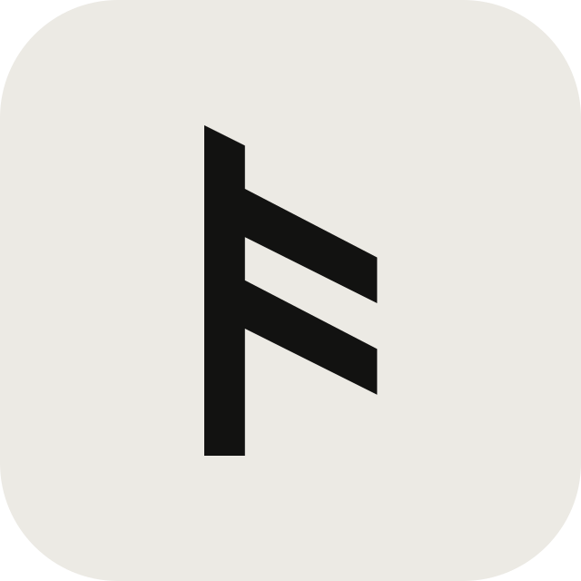
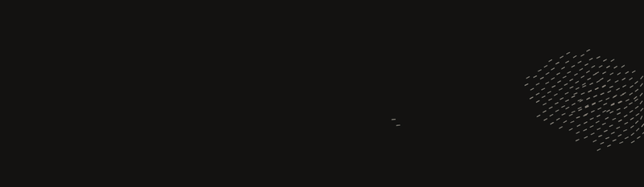

<p align="center"></p>

# Odin

**One desktop hub for all your coding-agent sessions.**

<p align="center"></p>

Odin lets you start, resume and organise agent sessions across all your projects and all your agent runtimes
(Claude Code, Codex, Grok, OpenCode, Antigravity) in one app. Sessions run on each tool's real native harness, so
your instruction files, skills, MCP servers, hooks and permissions behave the way they always do. Odin adds the
parts those tools don't have:

- **One place for every session**: streaming chat, tool calls, diffs, permission prompts and plan approval, with a
  tray badge and a notification when a session needs you. Sessions you start in a terminal show up too, and you
  can resume them.
- **A shared library**: instructions, skills, subagents, commands, MCP servers and settings profiles, kept once in
  `~/.odin/library/` (plain files, git-friendly), adapted to each runtime at launch, and installed into projects
  with drift detection.
- **Workspaces**: run a session in the project checkout or in a fresh git worktree on its own branch, across one
  or several repositories.
- **Measurement**: time, tokens, cost, diff size, and the outcome of the linked pull request, per session.
- **Artifacts and notebooks**: agents can post sandboxed interactive HTML and drive Python kernels you can inspect.

## Screenshots

**Home**: start a chat, and see every session that is running, paused for you, or finished.


**Session**: streaming chat with tool calls, terminal output, and a details panel for context, changes, background tasks and plan.


**Project overview**: time, cost, lines changed and commits per project, with a chart over 7 days, 30 days or 12 weeks.


> **Status:** early. Windows (including WSL runtimes) is the most-tested platform; the server and web app run
> anywhere Node 24 does, and prebuilt installers are not published yet.

## Quick start

You need Node 24 (22.18+ works), git, and at least one agent CLI installed and logged in.

```sh
git clone https://github.com/nurciuoli/odin.git
cd odin
corepack enable yarn        # Yarn 4 is pinned in package.json
yarn install
yarn build:web
yarn start                  # open http://127.0.0.1:8790
```

To try it without any agent CLI or model calls, start it with the scripted fake harness:
`ODIN_FAKE_HARNESS=1 yarn start`.

For the desktop app, build it from source with `yarn build:desktop` (Windows; see
[docs/desktop.md](docs/desktop.md)).

## Documentation

- [Overview](docs/overview.md): concepts and design decisions.
- [Architecture](docs/architecture.md): how the pieces fit.
- [Development](docs/development.md): setup, running, testing, environment variables.
- [Desktop shell](docs/desktop.md): the Electron app and packaging.
- [Contracts](docs/contracts.md): the API, events, harness and security rules.

## Contributing

Contributions are welcome. Read [CONTRIBUTING.md](CONTRIBUTING.md) first. To report a security issue, see
[SECURITY.md](SECURITY.md).

## License

[Apache License 2.0](LICENSE). The bundled Instrument UI component library (`packages/web/src/components`) is
under the same license; see [NOTICE](NOTICE).

Odin is an independent project and is not affiliated with Anthropic, OpenAI, xAI or the makers of the other
runtimes it supports.
