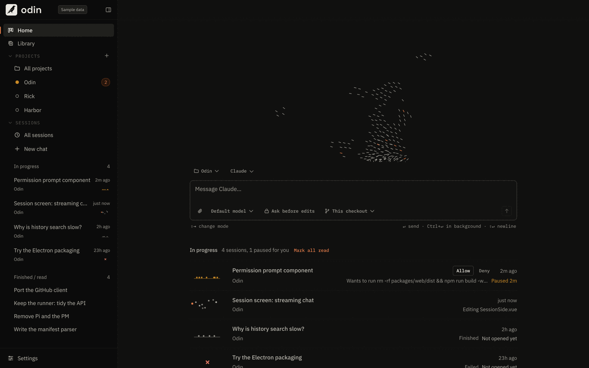
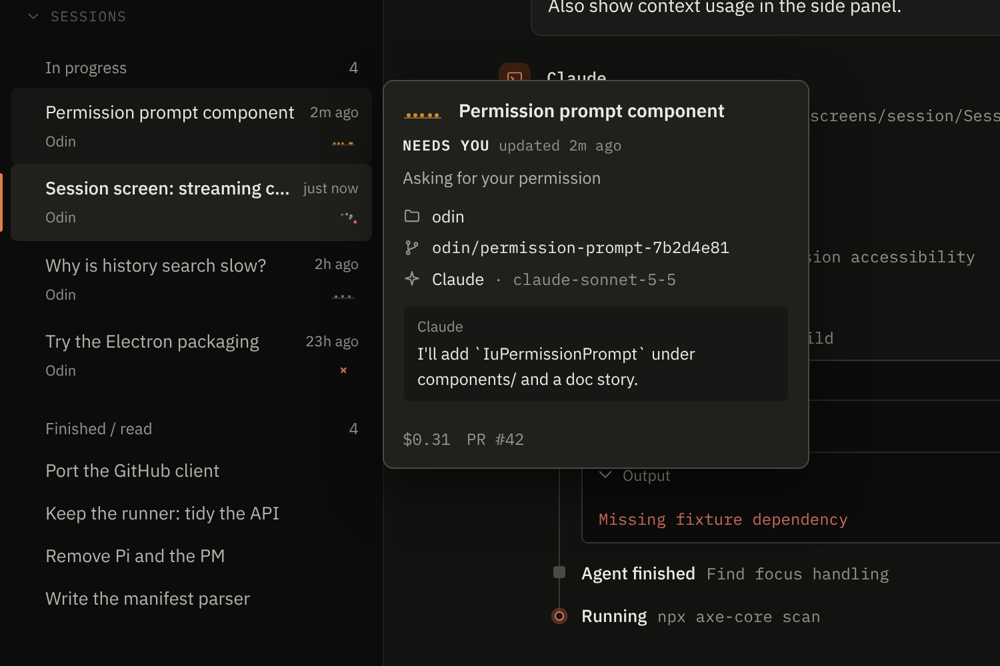
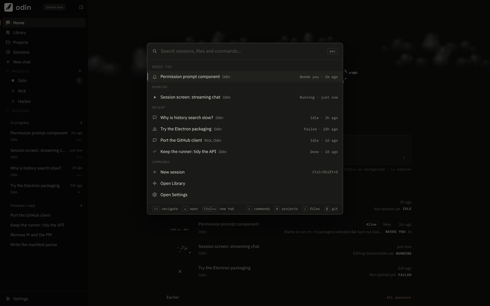
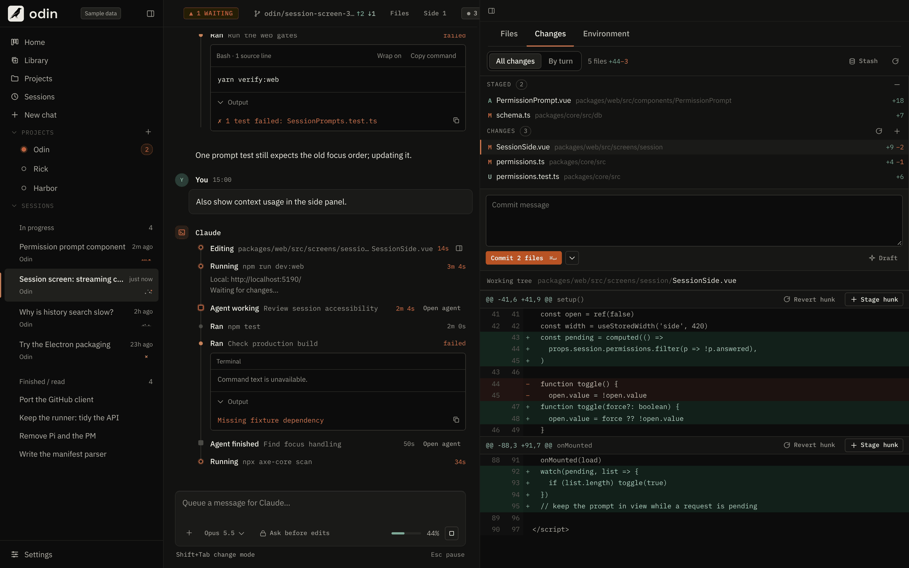
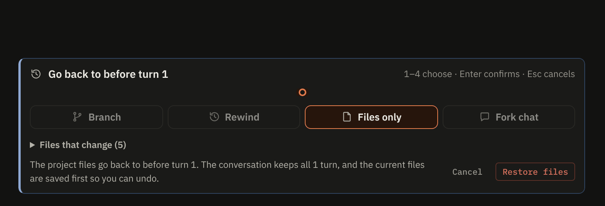
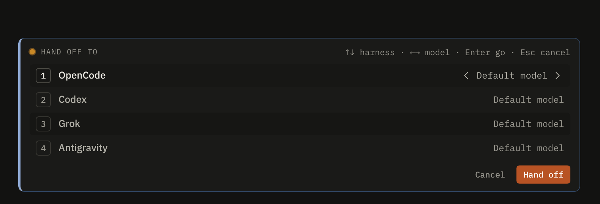
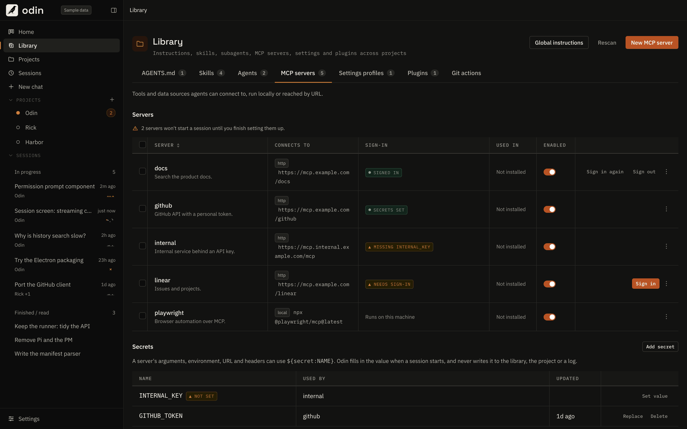
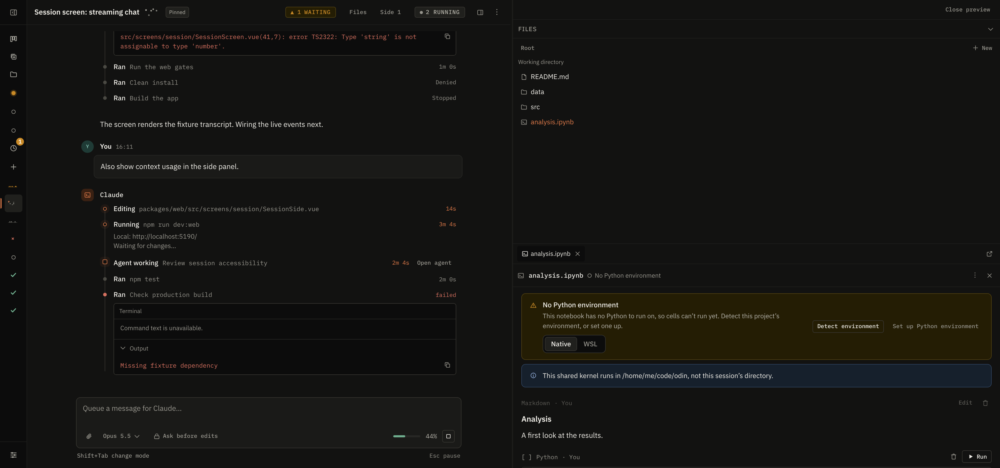

<p align="center"></p>

# Odin

**A bird's-eye view of every coding agent.**

<p align="center"></p>

Running several coding agents across several projects gets messy. Odin puts them in one calm place: see what is
running, what is waiting for you and what has finished, step in when it matters, and undo what you don't like.

It works with the agents you already use (Claude Code, Codex, Grok, OpenCode and Antigravity) and runs each one as
it normally runs, with your own instructions, skills, MCP servers and logins. There is nothing to migrate.



## What Odin helps you do

### Keep every agent in view

Home lists every session across every project and every agent, ordered by what needs you. Ravens flock while work
is under way, clouds roll in as more sessions start, and a flash of light marks one that finished or needs a
decision. Sessions keep running with the window closed, and a tray badge and notification bring you back. Sessions
you started in a terminal show up too, and you can pick them up where they left off.

Hover any project or session for a quick card: its branch, status, last message and cost.



### Find anything in a keystroke

`⌘K` (or `Ctrl+K`) searches sessions, projects, files and commands together, shows what you touched recently, and
can start a new session from whatever you typed. Type `>` for commands, `#` for projects, `/` for files and `@` for
branches. See [all shortcuts](docs/shortcuts.md).



### Stay in control of what changes

Review what an agent did file by file, hunk by hunk, line by line, or turn by turn. Stage or revert exactly what you
want, then commit with a message drafted from the session. Blame names the session and turn that wrote each line,
and checks your repo defines can run before a commit or push and stop a bad one. Switch or sync branches from the session
header, with a safe answer for uncommitted work.



### Undo anything, branch from anywhere

Hover one of your messages and rewind: branch from that moment in a new worktree, restore just the files (with an
Undo), move the session back, or fork the conversation. The project's Branches panel shows what is in flight as a
git tree, linked to each branch's sessions, worktrees and pull requests.



### Change agents without losing your place

Type `/handoff` and carry on in the same folder and branch with a different agent. Start on whichever agent fits
the task and change your mind later.



### Set it up once

Keep your instructions, skills, subagents, commands, MCP servers and settings profiles in one library of plain files
you can keep in git. Odin sets them up for each agent, shows when a project's copy has drifted from the library, and
keeps tokens in a secrets vault so they stay out of your config files.



### And the details

- **Know what it cost.** Time, tokens, cost, lines changed and the outcome of the linked pull request, per session
  and per project, with a chart over 7 days, 30 days or 12 weeks.
- **Give an agent its own branch.** Run a session in your checkout or in a fresh git worktree, across one or several
  repositories.
- **Decide when you're ready.** Permission prompts, plan approvals and questions wait for you; nothing is approved
  on your behalf.
- **See your own thread.** `⌥T` lists every message you sent down the side of the conversation.
- **Run a command inline.** Start a message with `!` to run a shell command in the session's folder and hand the
  output to the agent.
- **Look at what agents make.** Agents can post sandboxed interactive pages, and open, edit and run Jupyter notebooks
  beside the chat. Odin finds your project's Python environment for you.



More screenshots and walk-throughs are in the [guide](docs/guide.md).

> **Status:** early. Windows (including WSL runtimes) is the most-tested platform; the server and web app run
> anywhere Node 24 does, and prebuilt installers are not published yet.

## Quick start

You need Node 24 (22.18+ works), git, and at least one agent CLI installed and logged in.

```sh
git clone https://github.com/nurciuoli/odin.git
cd odin
corepack enable yarn        # Yarn 4 is pinned in package.json
yarn install
yarn build:web
yarn start                  # open http://127.0.0.1:8790
```

To try it without any agent CLI or model calls, start it with the scripted fake harness:
`ODIN_FAKE_HARNESS=1 yarn start`.

For the desktop app, build it from source with `yarn build:desktop` (Windows; see
[docs/desktop.md](docs/desktop.md)).

## Documentation

- [Guide](docs/guide.md): what you can do with Odin, task by task.
- [Keyboard shortcuts](docs/shortcuts.md): the palette, the session screen and the composer.
- [Overview](docs/overview.md): concepts and design decisions.
- [Architecture](docs/architecture.md): how the pieces fit.
- [Development](docs/development.md): setup, running, testing, environment variables.
- [Desktop shell](docs/desktop.md): the Electron app and packaging.
- [Hosting](docs/hosting.md): run Odin on an always-on computer and use it from other devices over Tailscale.
- [Contracts](docs/contracts.md): the API, events, harness and security rules.

## Contributing

Contributions are welcome. Read [CONTRIBUTING.md](CONTRIBUTING.md) first. To report a security issue, see
[SECURITY.md](SECURITY.md).

## License

[Apache License 2.0](LICENSE). The bundled Instrument UI component library (`packages/web/src/components`) is
under the same license; see [NOTICE](NOTICE).

Odin is an independent project and is not affiliated with Anthropic, OpenAI, xAI or the makers of the other
runtimes it supports.
