# Guide

What you can do with Odin, task by task. For the vocabulary (project, session, library) see the
[overview](overview.md); for every key binding see [shortcuts](shortcuts.md). The screenshots use sample data.

- [Run several agents without losing track](#run-several-agents-without-losing-track)
- [Find anything fast](#find-anything-fast)
- [Review and commit what an agent did](#review-and-commit-what-an-agent-did)
- [Undo, or branch from any point](#undo-or-branch-from-any-point)
- [Move a session to another agent](#move-a-session-to-another-agent)
- [Reuse your setup across projects](#reuse-your-setup-across-projects)
- [Work with files and notebooks](#work-with-files-and-notebooks)
- [See what your agents cost and ship](#see-what-your-agents-cost-and-ship)

## Run several agents without losing track

Start a session from **Home** or with `Mod+Shift+O`: pick a project (or several), an agent, a model, a permission
mode and where it runs (your checkout, or a new git worktree on its own branch), then type. Sessions started in a
terminal appear on their own, and you can resume them.

Home groups sessions by what needs you. A session that is waiting for a permission, an answer or a plan approval says
so in the list and can be answered from there. Ravens flock above the message box while work is under way, clouds
roll in as sessions start, and a flash of light marks one that finished or needs you. Closing the window does not stop
anything; the tray badge and a notification say when something needs you, and `Mod+J` jumps to the next session
that does.

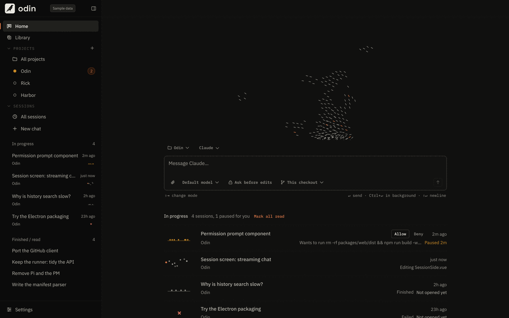

A permission prompt shows exactly what the agent wants to do, with Allow once, Always allow and Deny:

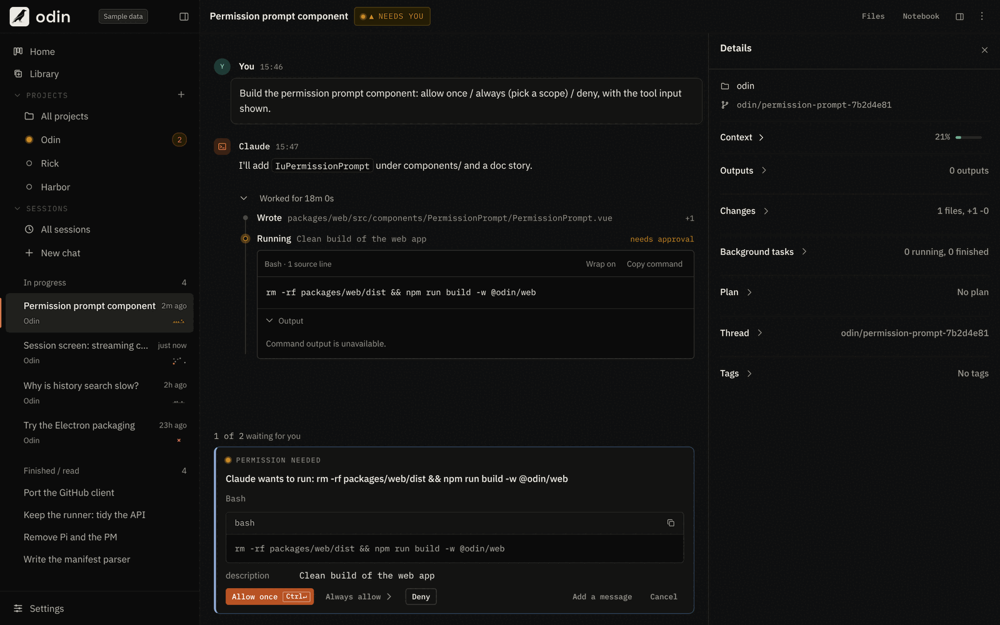

A session shows the conversation with its tool calls and diffs, and a Details panel for context, outputs, changes,
to-dos and background tasks, laid out as a branch graph of subagents and commands. **Session details** leads with
the branch. Project links and workspace path actions are under **This session**.

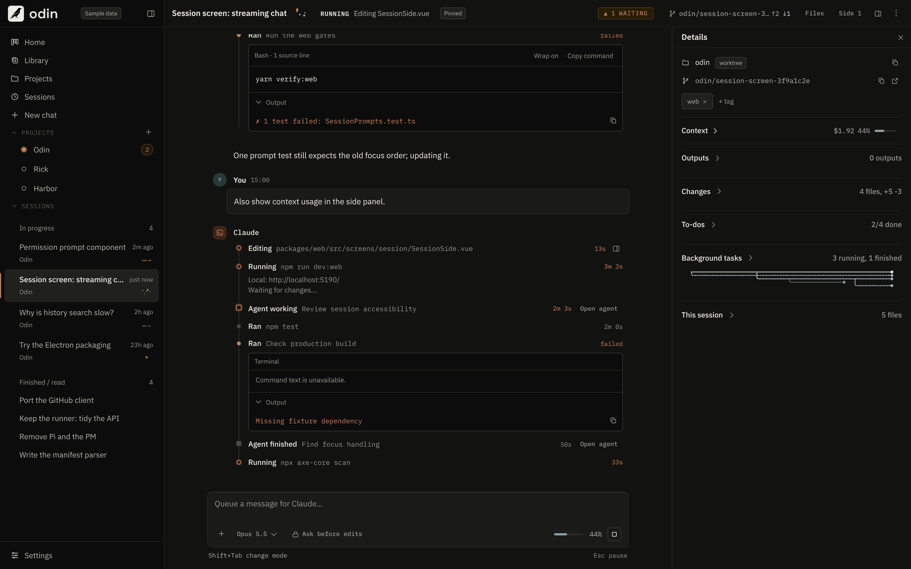

Hover a project or session in the sidebar for a quick card with its branch, status, last message and cost.

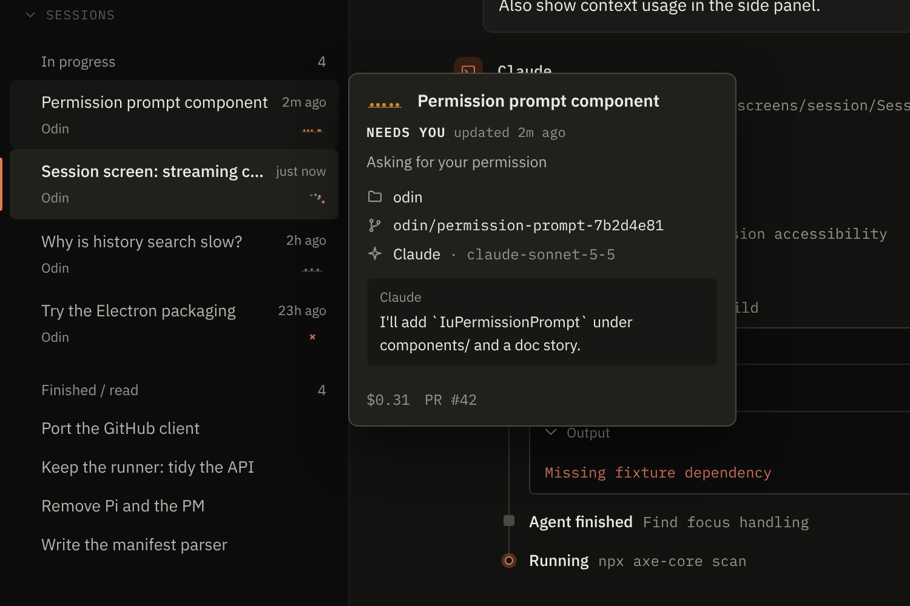

## Find anything fast

`Mod+K` opens the palette. Start typing to search sessions, projects, files and commands at once, or use a prefix:
`>` for commands, `#` for projects, `/` for files, `@` for branches. With nothing typed it shows what needs you and
what you used recently. If nothing matches, it can start a new session from your text, and it offers "New session on"
each installed agent.

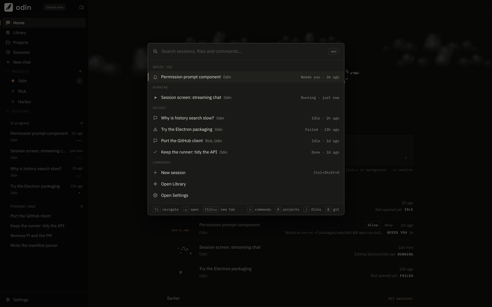

Inside a session, `Alt+T` lists every message you sent down the side of the conversation so you can jump back to a
step.

## Review and commit what an agent did

Open **Files** in the session header, then the **Changes** tab. It shows staged and unstaged files with their diffs.
Stage, unstage or revert a whole file, a single hunk or picked lines, or group the changes by the turn that made
them. Write a commit message, or start from the one Odin drafts from the session.

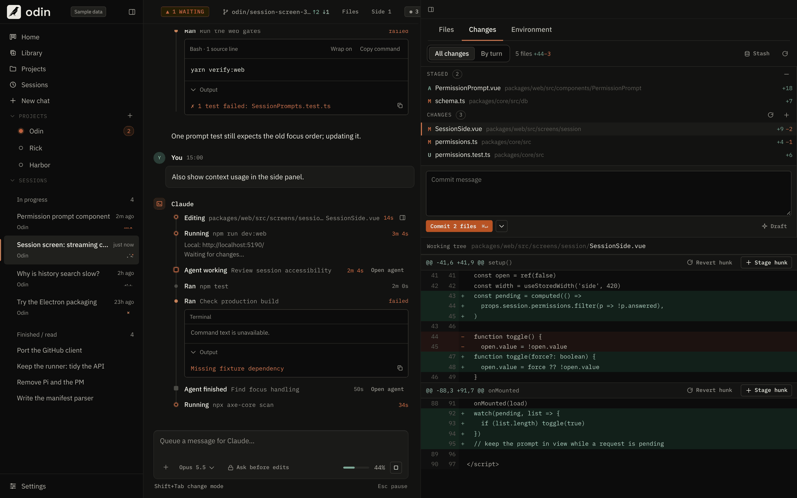

In the **Files** tab, the file browser stays above the open document so you can switch files in place. Docked
artifacts also open below the browser. Files opened from a session have **Code**, **Blame** and **History** views.
Blame names the Odin session and turn behind each line the agents wrote.

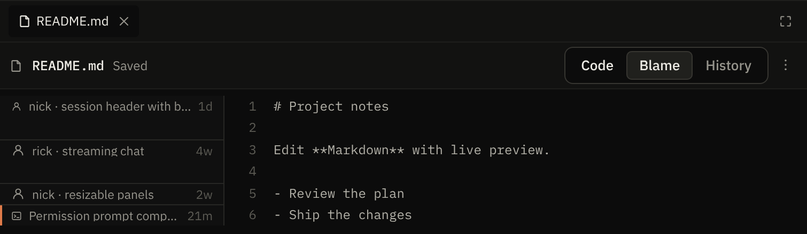

The branch in the session header shows commits ahead and behind. Click it, or press `Mod+B`, to switch branches, open
the session that has a branch in its worktree, create a branch, or fetch, pull and push. Switching with uncommitted
changes asks whether to stash them, carry them over, commit first or start a new session on that branch.

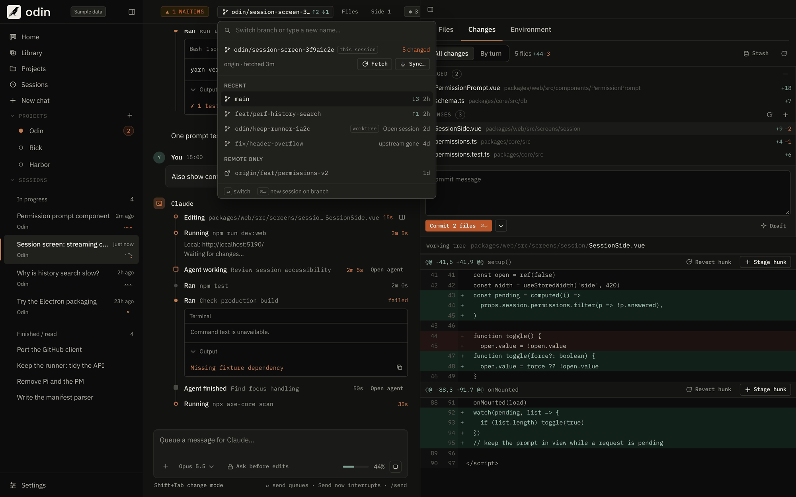

A repo can ask Odin to run its own checks before commits and pushes made from Odin, with JSON files in
`.odin/git-actions/`. A failing check shows its output in the Changes panel with **Ask Claude to fix**, **Run again**
and **Commit anyway**. The Library's Git actions tab lists them all.

## Undo, or branch from any point

Hover one of your messages in a session and press the rewind icon. The prompt that opens offers four ways back:

- **Branch**: start a new worktree from that point and leave this session alone.
- **Rewind**: move the session back to that point. It continues as a new session and the original is archived.
- **Files only**: put the project's files back as they were, with an Undo. The conversation keeps every turn.
- **Fork chat**: copy the conversation up to that point without touching the files.

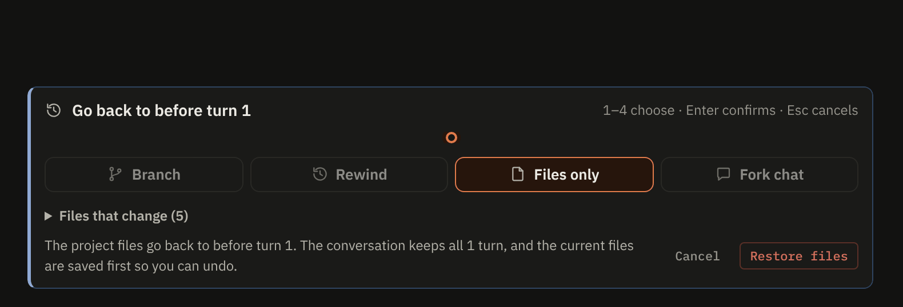

The project **Overview** shows branches as a git tree: the default branch as a trunk, open branches growing from it
and merged ones landing back. Each links to its GitHub branch, commit and pull request, its worktree and its
sessions. Switch between Graph and List, filter to Active, Merged or All, and zoom between Detailed and Compact.

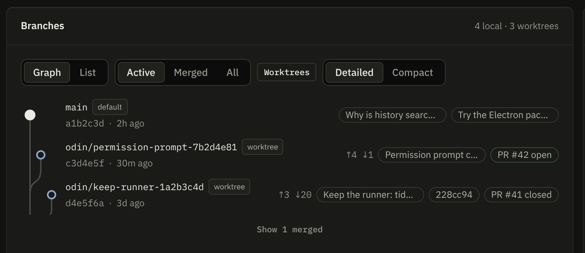

## Move a session to another agent

Type `/handoff` in the message box. A card lists each installed agent; arrow keys cycle each one's models and `↵`
continues the work there, in the same folder and branch. `/handoff codex` (optionally with a model) does it at once.
The new session links back to the old one.

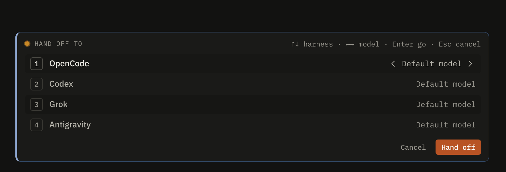

## Reuse your setup across projects

The **Library** keeps your reusable assets once, as plain files in `~/.odin/library/`: instructions, skills,
subagents, commands, MCP servers and settings profiles. Install an asset into a project and Odin tells you when the
project's copy drifts from the library, so you can update it, keep it or push your change back. Odin adapts each asset
to the agent you launch (for example, commands become Codex skills) and says what a runtime cannot express rather
than dropping it silently.

MCP servers that need a token use `${secret:NAME}` in their spec; Odin fills in the value from its secrets vault only
when a session starts, so tokens never sit in library files or `.mcp.json`. The MCP servers tab shows how each server
connects, whether it can start, and **Sign in** for servers that use OAuth.

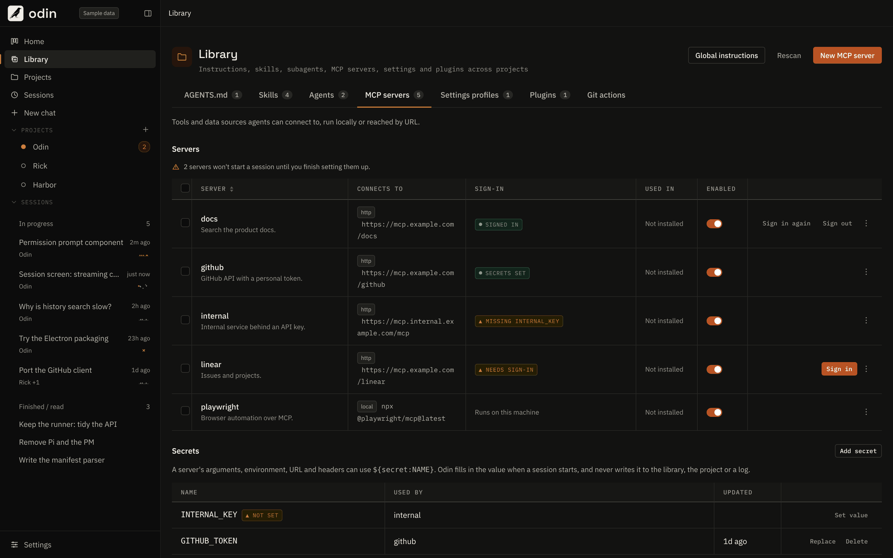

## Work with files and notebooks

**Files** in the session header opens the workspace beside the chat. Browse, preview and edit Markdown, code, JSON
and HTML, and create new files from the **New** menu.

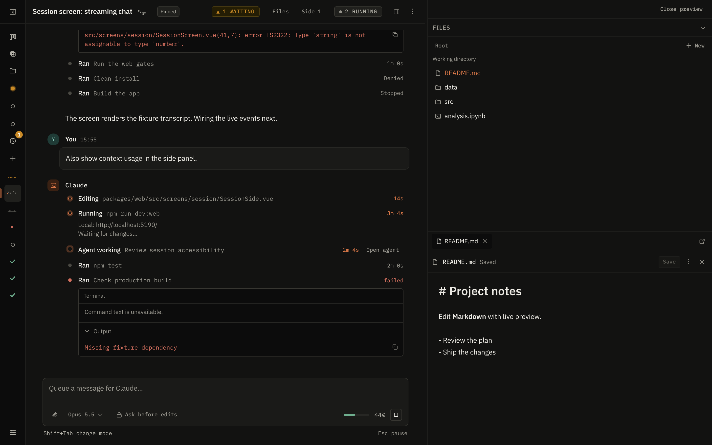

`.ipynb` files open as notebooks you can run. The kernel menu shows the active interpreter and working directory.
Use it to switch to a detected Python environment, including Conda, or to set up the Jupyter host and kernel.
**Kernel details** opens the Environment tab, where you can check the project's setup. Agents can drive the
same kernel. **Run all** runs cells in order and stops at a failed or interrupted cell.

For notebooks that read credentials from environment variables, list the variable names under `notebookEnv`
in the project's `PROJECT.md` frontmatter (for example, `notebookEnv: [FRED_API_KEY]`). Keep the values in the
project's `.env`. Restart the kernel after changing these settings.

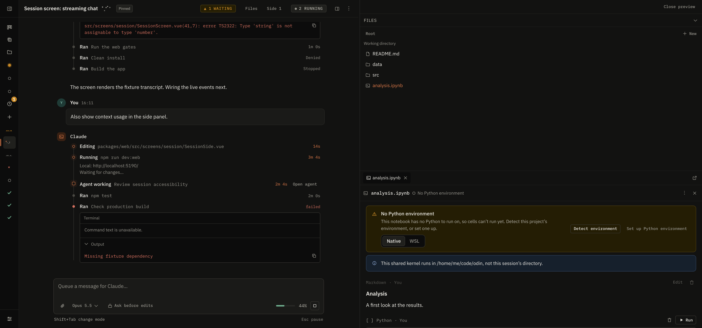

## See what your agents cost and ship

Each project's **Overview** shows sessions, active time, cost, lines changed and commits, with a chart over 7 days,
30 days or 12 weeks, the models you used and the pull requests your sessions produced. Each session carries its own
tokens, cost, time, diff size and the outcome of its pull request (GitHub is read-only and optional).

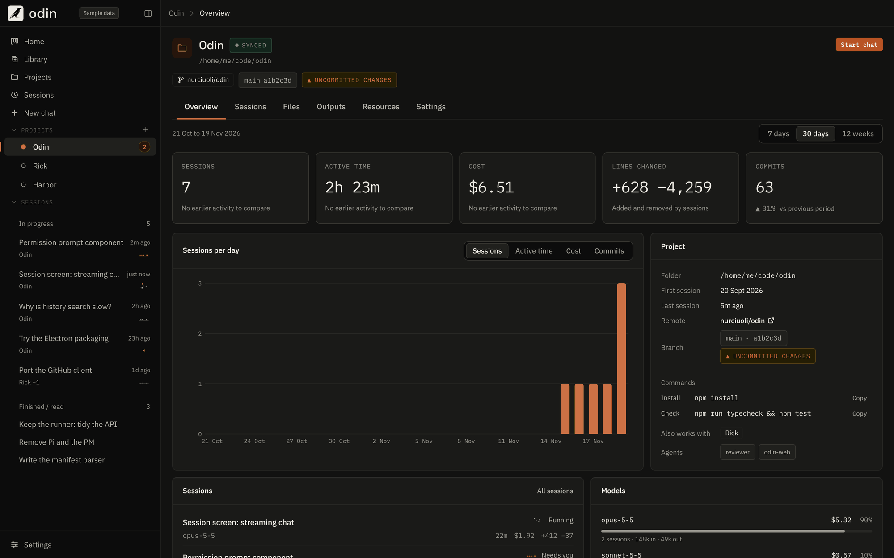
